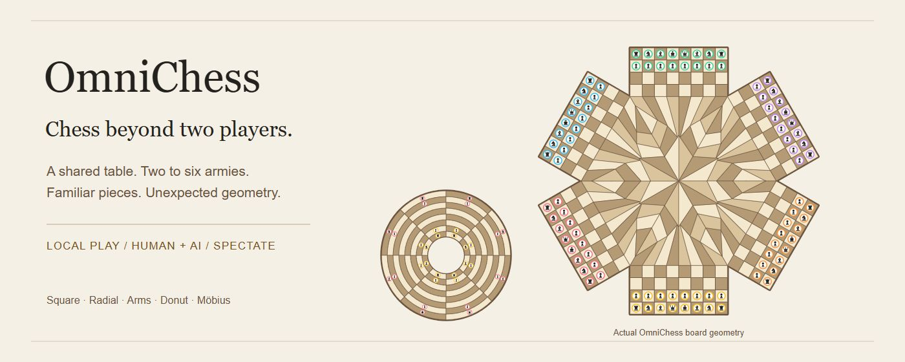
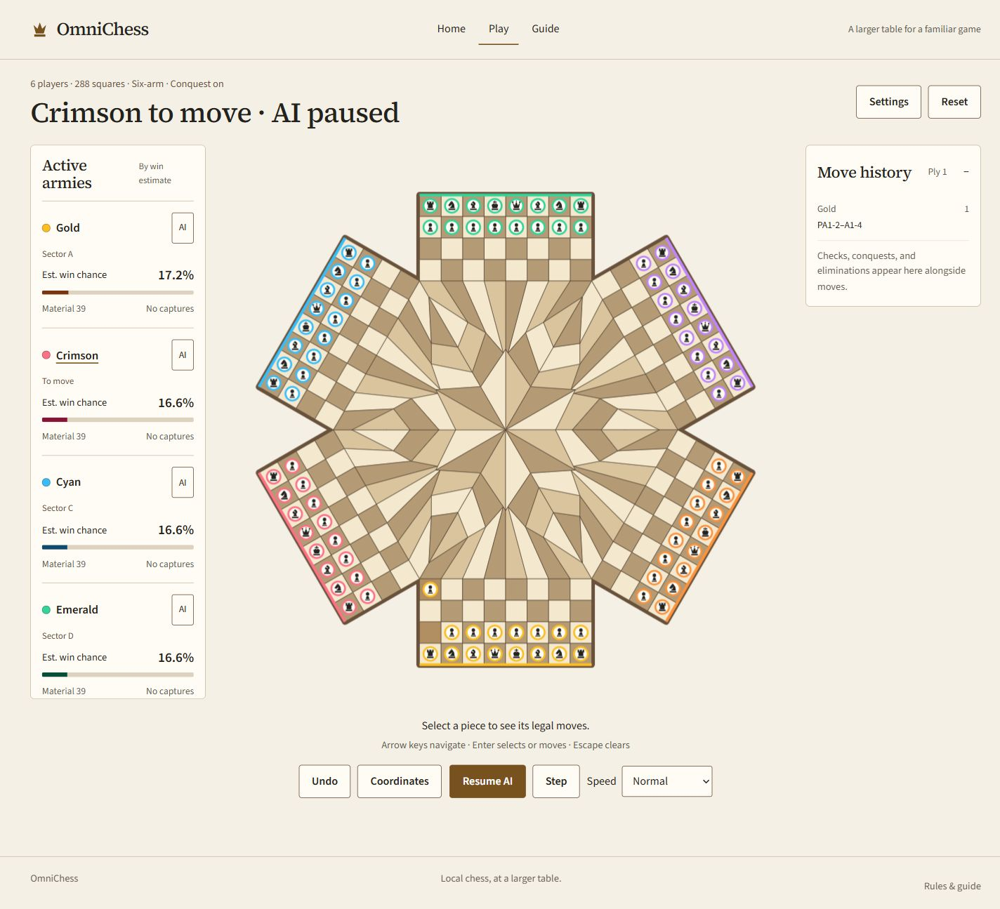

# OmniChess

An experimental chess playground for **two to six players**. Share one device with friends, play against AI, or watch the armies battle in spectator mode.

Built from a simple question: *what would chess look like if more than two armies shared the table?* OmniChess explores radial boards, rectangular arms, conquest, a donut, and a Möbius strip.

Vanilla JavaScript, Canvas, Vite, and Tailwind CSS. Static hosting; no account, backend, or runtime CDN required.

## Try it locally

Install **Node.js 24** and npm, then:

```sh
git clone https://github.com/knopnine/omnichess.git
cd omnichess
npm ci
npm run dev
```

Open the URL printed by Vite. Choose **Play a Match** or **Watch AI Play**, select a player count and board style, assign human/AI seats, and start.

Human players share the same screen and input device. Remote multiplayer is not implemented.

## Choose your table

Only styles available for your chosen player count appear in setup.

| Board | Players | Cells | What changes |
| --- | --- | --- | --- |
| Classic square | 2 | 64 | Standard chess, selected through the original Radial option. |
| Radial | 3–6 | 96–192 | Sector seams and branching central diagonals. |
| Three arms | 3 | 144 | Rectangular home arms and a triangular central field. |
| Cross | 4 | 192 | Four square-cell arms around an 8×8 center; straight grid movement. |
| Five-arm | 5 | 240 | Five home arms surrounding a pentagonal field. |
| Six-arm | 6 | 288 | Six home arms surrounding a hexagonal field. |
| Donut | 2 | 64 | Circular board; files a/h connect at the same rank. |
| Möbius | 2 | 112 | Unfolded 8×14 strip, two pawn fronts per army, and a twisted join. |

Pieces keep one size per board, including during animation. Fitted cells keep pieces and ownership rings inside their tiles. Dense boards still become small on narrow screens.



## Play, watch, and experiment

- Mix human and AI seats, or make every army AI-controlled.
- Enable multiplayer **conquest** to take control of defeated armies' remaining pieces.
- Alternatively, freeze/remove defeated armies, or play **first checkmate wins**.
- Follow ranked army cards with material, captures, and dynamic win estimates.
- Watch pieces move, captures fade, and both pieces animate during castling. Reduced-motion preferences are respected.
- Pause AI, step through one move, and choose Turbo, Normal, or Cinematic speed.
- Use hints, coordinates, move history, and local Undo.

Win estimates compare material, mobility, pawn progress, threats, and king safety. They are **uncalibrated heuristics**, not measured probabilities, and do not predict draws. AI is also heuristic: this is a playground rather than a strong chess engine or training service.

### Controls

| Action | Control |
| --- | --- |
| Select or move | Click/tap a piece, then a legal destination. |
| Navigate the board | Arrow keys. |
| Select/move with the keyboard | Enter or Space. |
| Clear selection | Escape. |
| Human-mode Undo | Remove the latest retained human move and following AI replies. |
| Spectator Undo | Remove one ply and remain paused. |
| Step | Commit one AI move and remain paused. |

Legal moves use dots; captures use dashed rings. Settings and Guide suspend AI. Leaving the arena or restoring a save pauses AI until explicitly resumed.

## Rules worth knowing

**Classic chess** supports king safety, checkmate, stalemate, castling, en passant, and all four promotions. Kings cannot be captured. Repetition, 100 half-moves without a pawn move/capture, and common insufficient-material positions automatically draw. This is a simplified casual policy, not complete tournament adjudication.

**Multiplayer sector boards** use seam movement and branching diagonals. Pawns advance inward in their owner's sector, then outward through opposing sectors, promoting at an opposing back rank. Conquered pawns follow the new owner's direction. Two-player draw rules do not apply to multiplayer; stalemate eliminates an army. The three-arm center adapts this graph rather than reproducing a regular diamond lattice.

**Cross** uses straight square-grid rook/bishop movement and ordinary knight jumps. Pawns keep their army's forward direction and promote at the opposite outer back rank.

**Donut** is an annular experiment with cylindrical movement: a/h files join, but ranks 1/8 remain boundaries. Gold begins inside, Crimson outside. It is not a torus joining both pairs of edges.

**Möbius** follows [Alberto Monteiro's reference](https://www.chessvariants.com/shape.dir/x_moeb.html) and its [cylindrical setup](https://www.chessvariants.com/shape.dir/x_cylind.html). Each army has 24 pieces. Gold occupies back rank 1 and pawn ranks 2/14; Crimson occupies back rank 8 and pawn ranks 7/9. Rank 14 joins 1 normally. Between 11/12, files reverse: a11 joins h12. Bishops can change square color. Gold promotes on 8, Crimson on 1. The strip is displayed unfolded so every cell stays visible.

Donut and Möbius retain king safety, home-rank castling, en passant, repetition, and the move-count draw. Their automatic material draw is limited to king versus king. Earlier 8×8 Möbius saves retain their original experimental rules; new matches use the reference version.

The in-game **Guide** explains movement, joins, conquest, and draw policy.

## Local saving

Committed positions and settings autosave to one versioned browser-local slot, including recent moves and up to **35 Undo snapshots**. Pending promotions restore the preceding committed position. Invalid/unsupported saves are left untouched; storage errors show a nonblocking message while play continues.

Saves belong to one browser, device, and origin. They do not sync between devices or Vercel preview/production URLs. Export/import, cloud saving, replay, and online multiplayer are not implemented.

## Development

| Command | Purpose |
| --- | --- |
| `npm run dev` | Start Vite's development server. |
| `npm test` | Run engine, rules, geometry, saves, timers, animation, and interface tests. |
| `npm run build` | Produce the static site in `dist/`. |
| `npm run preview` | Serve the production build locally. |

Classic starting-position perft is checked against **20, 400, and 8,902** through depth three. Variant coverage includes joins, conquest, elimination, wrapping, promotion, and Möbius pawn fronts. See [release verification](docs/verification.md) for checks and screenshots.

```text
src/engine/   DOM-independent topology, rules, state, AI, estimates, saves
src/ui/       Canvas rendering, animation, screens, and controls
tests/        Engine and interface regression coverage
docs/         Verification, screenshots, and README artwork
scripts/      Offline geometry fitting and hero SVG generation
legacy/       Original single-file prototype
```

Grid templates are checked in; normal builds do not run the optimizer. Regenerate them with `node scripts/fit-board-grids.js`. The hero's editable source is [docs/hero.svg](docs/hero.svg), generated by `node scripts/create-hero.js` from the game engine.

Serve over HTTP; opening `index.html` as a local file is unsupported. Hash routes are `#/`, `#/setup`, `#/play`, and `#/guide`. The old `/omnichess_modern.html` address redirects to the introduction. The original prototype in `legacy/` is excluded from production.

## Deploy to Vercel

1. Import this repository into Vercel.
2. Use the repository root and **Vite** framework preset.
3. Build with **`npm run build`**, output **`dist`**, and **Node.js 24**.
4. Check a preview: navigation, all player counts/styles, spectator controls, and refresh recovery.
5. Promote the verified preview; retain the previous deployment for rollback.

`vercel.json` supplies the Vite build configuration. Hash routes need no application rewrites. No database, server functions, secrets, or environment variables are required. Pushing to GitHub does not itself deploy unless a hosting integration is already connected.

## Credits

- Möbius rules: [Alberto Monteiro, The Chess Variant Pages](https://www.chessvariants.com/shape.dir/x_moeb.html).
- Locally bundled **Source Serif 4** and **Source Sans 3**; see their [Serif license](public/source-serif-4-license.txt) and [Sans license](public/source-sans-3-license.txt).
- Chess silhouettes are local SVG paths. The hero uses OmniChess's own geometry and pieces.

OmniChess combines familiar chess with experimental board and multiplayer rules. It does not claim tournament-standard adjudication for every variant.
